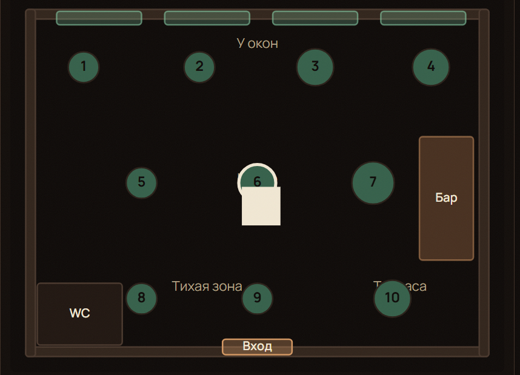

# AGENTS.md — Tactile Craft Coffee & Bakery

> Контекстный файл для агентов и новых участников. Читать первым при входе в проект.

## Что это за проект

Веб-приложение кофейни с тремя ядрами:

1. **Интерактивное меню по слоям** — каждое блюдо раскладывается на слои (`basePositionY`/`explodeOffsetY` в конфиге), на странице блюда — полномасштабное фото и «указатели» слоёв с названием, граммовкой и КБЖУ. Кастомизация слоёв (убрать/добавить) реактивно пересчитывает цену и калории через единый калькулятор.
2. **Карта бронирования столов** — защита от овербукинга через атомарный лок в Upstash Redis (`lock:table:{id}:{slot}`, TTL 10 минут) + realtime-рассылка статусов через Supabase Realtime (3D-диорама зала — в Фазе 4).
3. **Telegram-бот** — доставка (геолокация, полигон зоны), предзаказ к столику с триггером «🔥 Готовить сейчас» за 15 минут до брони.

## Структура монорепозитория (Turborepo + pnpm)

```
apps/
  web/        Vite 6 + React 19 + react-router 7 + Tailwind 4 + Redux Toolkit/RTK Query, FSD-архитектура
  api/        Hono 4 + @hono/node-server — HTTP API (порт 4000), единственное приложение с доступом к БД
  bot/        grammY (conversations, menu), smoke-скелет до Фазы 5
packages/
  shared/     @repo/shared — типы, Zod-схемы, калькулятор цены/КБЖУ, моки меню и столов
  database/   @repo/database — Prisma-схема, PrismaClient singleton, Redis-локи, seed, мапперы Decimal→number
  typescript-config/  общие tsconfig (base / react / node)
```

Пакеты `shared` и `database` отдаются как TS-исходники (без build-шага). Подробная карта всех файлов («что за что отвечает») — в `STRUCTURE.md`.

### Архитектурная граница web ↔ api

- **Web НЕ импортирует `@repo/database`** — весь доступ к данным только по HTTP через RTK Query (`@/shared/api/baseApi`).
- **API НЕ импортирует код из web** — shared пакеты являются общим слоем (типы, Zod, калькулятор, моки).
- Vite dev-сервер проксирует `/api → http://localhost:4000` (см. `apps/web/vite.config.ts`).

### FSD-структура `apps/web/src`

```
app/          точка входа (main.tsx), router.tsx, store/, providers/, styles/ (дизайн-система)
pages/        home/ menu/ menu-item/ booking/ checkout/ tma/ — композиция виджетов и фичей
widgets/      app-header/ app-footer/ hero-showcase/ menu-item-viewer/ — крупные самодостаточные блоки
features/     cart/ book-table/ menu-customizer/ coffee-builder/ — пользовательские сценарии
entities/     menu-item/ table/ order/ — бизнес-сущности (RTK Query API + UI)
shared/       api/ lib/ ui/ config/ — инфраструктура, не зависящая от бизнеса
```

**Дизайн-система** — в `app/styles/index.css` (Tailwind 4 `@theme`): палитра «вечерний эспрессо-бар» (ink-900…500, gold, cream, mint, rose-warm в OKLCH), шрифты Playfair Display + Manrope, зернистая текстура, компонентные классы `.btn`/`.card`/`.chip`/`.nav-pill`/`.eyebrow`/`.field-input`, анимации `--animate-cp-in` и `--animate-float`. Hero-фото — виджет `hero-showcase` + класс `.hero-center-photo`.

**Фото напитков** — `public/drinks/*.jpg` + маппинг `shared/lib/drink-image.ts` (по slug и по id; fallback — `LayerStackSvg`).

**Правила FSD:**

- Иерархия слоёв: `app > pages > widgets > features > entities > shared`. Импорты разрешены **только вниз** (слой выше может импортировать слой ниже, но не наоборот и не «вбок» на своём уровне — исключение: cross-import entities через публичное API).
- Внутри слайса — сегменты: `api/` (RTK Query эндпоинты), `model/` (Redux-слайсы, типы), `ui/` (компоненты), `lib/` (утилиты), `index.ts` (публичный API слайса).
- Импортировать слайс только через его `index.ts`; внутренние пути наружу не экспортируются.
- Алиас `@/` → `apps/web/src/` (vite + tsconfig paths).
- Слайсы фичей типизируют стейт через `import type { RootState } from "@/app/store"` — это намеренная type-only цикличность, рантайм-цикла нет.
- RTK Query API живут в entities (`entities/menu-item/api/menuApi.ts` и т.д.) и регистрируются в `app/store/index.ts` явными импортами (`import "@/entities/menu-item"`).

### API-роуты `apps/api`

| Метод и путь (basePath `/api`) | Назначение                                                             |
| ------------------------------ | ---------------------------------------------------------------------- |
| `GET /health`                  | healthcheck                                                            |
| `GET /menu`                    | меню из БД, фолбэк на MOCK при отсутствии `.env`                       |
| `GET /tables?date&slot`        | статусы столов на слот (FREE/HELD/OCCUPIED + Redis-локи)               |
| `POST /tables/hold`            | холд стола на 10 минут + broadcast в Supabase Realtime                 |
| `DELETE /tables/hold`          | снять холд (только свой)                                               |
| `POST /orders`                 | создать заказ; цена пересчитывается на сервере, клиентской не доверяем |
| `GET /orders?id=`              | статус заказа                                                          |
| `PATCH /orders/:id/trigger`    | триггер «Готовить сейчас»                                              |

- Идентификация гостя: заголовок `x-guest-id` (генерируется в `web/shared/lib/guest-id.ts`); гостевой пользователь в БД — `guest@tactile.local`.
- Порт берётся из `PORT` env (по умолчанию 4000).
- Без заполненного `.env` API работает в мок-режиме: `/menu` и `/tables` отдают моки, заказы и холды возвращают 503 (нет БД/Redis).

## Команды (корень)

| Команда                      | Что делает                                  |
| ---------------------------- | ------------------------------------------- |
| `pnpm dev`                   | dev-серверы web (5173) и api (4000) (turbo) |
| `pnpm build`                 | сборка                                      |
| `pnpm lint` / `lint:fix`     | ESLint (flat config, `eslint.config.mjs`)   |
| `pnpm format` / `format:fix` | Prettier check / write (`.prettierrc.json`) |
| `pnpm typecheck`             | `tsc --noEmit` по всем пакетам через turbo  |
| `pnpm ci:check`              | lint + typecheck + build                    |
| `pnpm db:generate`           | генерация Prisma Client                     |
| `pnpm db:push` / `db:seed`   | применить схему / наполнить БД              |

Проектные команды агента лежат в `.kimi-code/skills/`: `/формат` (полный цикл проверки кода), `/заключение` (отчёт сессии в `.docs/history/YYYY-MM-DD_coffee-summary.md`).

## Ключевые контракты

- **Единый источник правды для цены/КБЖУ** — `packages/shared/src/utils/price-calculator.ts`: `calculateItemTotals(item, activeLayerIds)`. Используется API (серверный пересчёт при создании заказа), фронтом (customizer) и ботом. Правила: `unitPrice = basePrice + Σ priceModifier активных слоёв`; удаление базового слоя не уменьшает цену; `baseCalories` блюда = надбавка поверх слоёв (в моках = 0, вся КБЖУ в слоях).
- **Слепок кастомизации** — `CustomConfiguration { activeLayerIds, removedTitles, addedTitles }` хранится в `OrderItem.customConfiguration` (JSON).
- **3D-конфиг слоя** — тип `MenuItemLayerConfig` в `packages/shared/src/types/three-menu.types.ts`: `basePositionY` (собрано), `explodeOffsetY` (разлёт), `heightScale`/`radiusScale` (процедурный примитив), `labelPosition` (выноска `<Html>`), материал (`colorHex`, `opacity`, `roughness`). Там же `MenuResponse` (контракт ответа API).
- **Fallback-рендер**: если `MenuItem.modelUrl === null` — слои рендерятся примитивами (`primitiveType`: CYLINDER/BOX/SPHERE/TORUS), .glb не нужны.
- **Локи столов** — `packages/database/src/redis.ts`: `lockTable/unlockTable/getTableLocks`, ключ `lock:table:{tableId}:{slotStartIso}`, TTL 600 сек; снять чужой лок нельзя (проверка `userId`). Слот брони — 90 минут.
- **Realtime-пейлоады и конфиг столов** — типы в `packages/shared/src/types/realtime.types.ts` (`TableStatusPayload`, `OrderStatusRealtimePayload`, `TableSlotStatus`, `HoldTableResponse`, `CafeTableConfig`, `TABLE_ZONES`). Подписка на канал `cafe-tables` — в `bookingApi.onCacheEntryAdded` (`entities/table`).
- **Типы ответов API** — `packages/shared/src/types/api.types.ts`: `CreateOrderResponse`, `OrderStatusResponse`, `ApiErrorResponse`.
- **Валидация** — Zod-схемы в `packages/shared/src/schemas/` (бронь, заказ, адрес + полигон доставки `isPointInDeliveryZone`). Одни и те же схемы на фронте, в API и в боте.
- **Мапперы БД → shared** — `packages/database/src/mappers.ts`: Decimal→Number, JSON→типизированные кортежи (с runtime-гардами). API возвращает только shared-типы, никаких Prisma-объектов наружу.

## База данных

Схема: `packages/database/prisma/schema.prisma` — 8 моделей (`User`, `Address`, `Category`, `MenuItem`, `MenuItemLayer`, `CafeTable`, `Booking`, `Order`, `OrderItem`), 6 enum'ов. `User.telegramId` — BigInt (в `client.ts` патч `BigInt.prototype.toJSON`). Seed: `packages/database/seed.ts` (идемпотентный, берёт меню из `@repo/shared` моков).

Seed берёт меню из моков `@repo/shared`. Деплой web на Vercel — `vercel.json` + `.docs/deploy-vercel.md` (API — отдельный хост).

## Окружение

Шаблон — `.env.example`: `DATABASE_URL`/`DIRECT_URL`, `VITE_SUPABASE_*`, `NEXT_PUBLIC_SUPABASE_*`, `UPSTASH_REDIS_REST_*`, `BOT_TOKEN`, `WEBAPP_URL`. Postinstall Prisma/esbuild — `onlyBuiltDependencies` в `pnpm-workspace.yaml`.

Supabase Realtime: канон `SUPABASE_URL` / `SUPABASE_ANON_KEY`; web — `VITE_SUPABASE_*` (те же значения); API читает `SUPABASE_*` → `VITE_*` → `NEXT_PUBLIC_*` (legacy).

## Правила разработки и работы агентов

### 1. Правила кода

- **Строгий TypeScript**: Без `any` без крайней нужды. Используйте `unknown` + Zod.
- **Валидация**: Все внешние данные (API, БД, формы) валидируются Zod-схемами из `packages/shared`.
- **Статусы**: Только константы из `shared`, никаких строковых литералов (magic strings).
- **База данных**: Каждый запрос к БД ограничен `workspace_id` (RLS + явный фильтр в коде).
- **Секреты**: Только в `.env`. В репозитории — `.env.example` с пустыми значениями. Web env — только `VITE_*`.
- **FSD Архитектура**: Импорты строго вниз (`app > pages > widgets > features > entities > shared`). Публичный API слайса — только через `index.ts`. Бизнес-логика не должна утекать в `apps/*` — только в `packages/shared`.

### 2. Правила работы агентов (Workflow)

- **Stop & Check**: Если запрос нарушает правила (например, `localStorage` в UI, `any`, импорт БД в web), **сразу скажи об этом** до написания кода.
- **План без ожидания**: Кратко опиши план (файлы + правила) и сразу реализуй. Задавай вопросы только если без ответа нельзя выбрать поведение.
- **Дебаг**: Ошибка → скилл `systematic-debugging` (сначала найти причину, потом патчить).
- **TDD**: Код в `packages/*` → скилл `tdd-packages` (тест первым). UI проверяется в браузере.
- **STOP**: Остановись и спроси, если нужно выбрать между конфликтными архитектурными решениями, требуется destructive git (`push --force`, `hard reset`) или коммит секретов.
- **Коммиты**: Только по явной просьбе. Формат — Conventional Commits. Без `Co-authored-by: Cursor`.

### 3. Definition of Done (DoD) — Обязательно перед сдачей

Перед финальным ответом пользователю агент **обязан** запустить проверки и исправить все ошибки:

1. `pnpm ci:check` (включает `lint`, `typecheck`, `format`) — должен быть зелёным.
2. При правках `packages/*` — дополнительно `pnpm test`.
3. Если менялась схема БД: `pnpm db:types` и проверка типов.
   _Не отдавай код с ошибками в надежде, что «потом починят»._

### 4. Изменения схемы БД

- `supabase migration new <name>` — существующие миграции не править.
- RLS настраивается в той же миграции.
- `pnpm db:types` для обновления типов.
- Статусы/поля синхронно обновляются в Zod-схемах `shared`.

### 5. Скиллы и субагенты (.cursor/)

**Скиллы (.cursor/skills/):**

- `/формат` → `format:fix` → `lint:fix` → `typecheck` до зелёного.
- `/заключение` → отчёт в `.docs/history/` + обновление `STRUCTURE.md`.
- `systematic-debugging`, `verification-before-completion`, `receiving-code-review`, `dispatching-parallel-agents`, `tdd-packages`.

**Субагенты (.cursor/agents/):**

- `arch-reviewer` — read-only ревью FSD / границ пакетов / Zod / `workspace_id` и сверка `AGENTS.md` + `STRUCTURE.md` + `README` + `ROADMAP` с кодом. **Чек-лист ревью — в `REVIEW.md`**.

### 6. Рабочий процесс (Спринты)

- Перед спринтом читай `.docs/HANDOFF.md` (если новая машина) и бриф текущего спринта.
- Следующий незакрытый спринт в `ROADMAP.md` — приоритет.
- После спринта: `[x]` в `ROADMAP` + обновить «Текущее состояние» в `.docs/PROJECT-MEMORY.md`; новый бриф — в `.docs/memory-sprint-X.Y.md`.
- Один логический спринт = один коммит (или PR).

## Правила Кода

Ни одна задача не считается выполненной, пока код не проходит все проверки. Агент **обязан** самостоятельно запустить их в терминале перед тем, как отдать результат пользователю.

**Обязательный чек-лист перед сдачей задачи:**

Строгий TypeScript (strict: true), без any без крайней нужды.
Все внешние данные (формы, API, вебхуки, конфиги принтеров, пейлоады из парсеров) валидируются Zod-схемами из packages/shared.
Статусы заказов/принтеров/материалов — только из констант shared, строки-литералы в коде запрещены.
Мультитенантность: каждый запрос к БД обязан быть ограничен workspace_id (на уровне RLS + явного фильтра).
Секреты — только через .env, коммитить .env.example с пустыми значениями.

## Roadmap и статус

- [x] **Фаза 1** — монорепо, Prisma-схема, shared-типы/Zod/моки, ESLint+Prettier, скелеты apps. Валидация пройдена: `prisma generate`, `typecheck`, `lint`, `format` — зелёные (03.11.2026)
- [x] **Фаза 2** — переход web на Vite + React 19 + react-router 7 по FSD; API вынесен в `apps/api` (Hono); Redux Toolkit + RTK Query: `menuApi`, `bookingApi` (Realtime в `onCacheEntryAdded`), `orderApi`, слайсы `cart`/`customizer`/`scene3d`; страницы menu/booking/checkout/tma. Валидация пройдена: `typecheck` 5/5, `lint` 0 ошибок, `format` чисто, `vite build` успешен, smoke API (health/menu/tables) и Vite-прокси — OK (03.11.2026)
- [x] **Фаза 3** — страница блюда: полномасштабное фото + «указатели» слоёв (название, граммовка, ккал) с реактивным пересчётом цены/КБЖУ (03.11.2026)
- [x] **Фаза 3.5** — тёмная тема, лендинг (hero + Current Pick), Coffee Builder (`custom_coffee`). R3F/3D UI и `scene-3d`/`hero-3d` удалены; страница блюда — фото + состав. Валидация: typecheck/lint/build OK (03.11.2026; чистка 10.11.2026)
- [x] **Фаза 4** — 2D-карта зала (окна/дверь/WC/бар/столы), Booking(HELD) при холде, DINE_IN в checkout по `bookingId`, унификация Supabase env (11.11.2026)
- [ ] **Фаза 5** — Telegram-бот grammY: Платная доставка(бесплатно от 30р) авторизация(Варианты: 1. Имя и телефон с телеграмма. 2. Пользователь вводит имя, телефон, после чего выпадающее меню - app приложение с картинками товара, выбор доставки, и дату/время), доставка, триггер бариста за 15 минут, live-трекинг статуса.

## Переделать (статус → `.docs/memory-sprint-polish.md`)

1. Главная страница фоновая картинка слишком растянуюта. из за чего качество ужастное, сделай меньше.
2. Страница меню - убери надпись деморежим. В первую очередь данные должны идти из бд
3.  - при выборе места появляется белый квадрат - исправь.Так же не бронируется место, должна быть форма
   с вводом номера телефона , имени и выбором времени.А там где надпись бронирование и ниже календарь - нужно при выборе показывать,
   какие места свободны/заняты. обычно бронирование идет на 2 часа следовательно если я выберу на 16.00 то к 18.00 должно показывать что место свободно
   Сделай для этого моковые данные.
